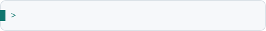
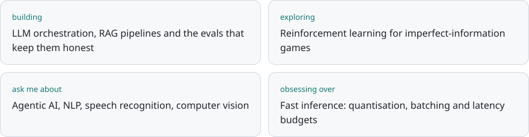
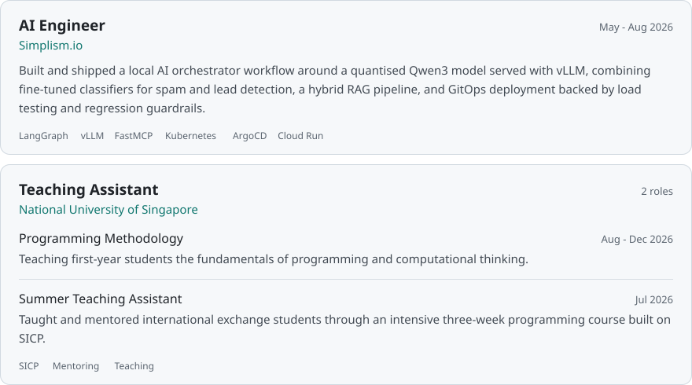
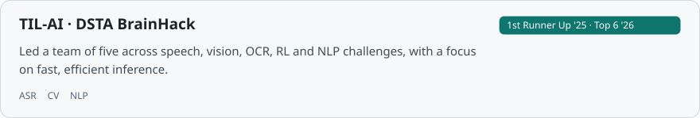
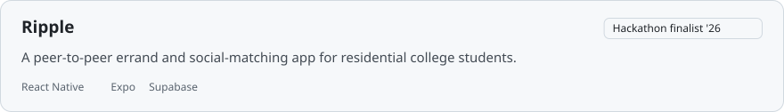

<picture>
  <source media="(prefers-color-scheme: dark)" srcset="./assets/titlebar-dark.svg" />
  
</picture>

 

<picture>
  <source media="(prefers-color-scheme: dark)" srcset="./assets/header-dark.svg" />
  
</picture>

### AI Engineer · CS + Math @ NUS · Singapore

`# builds agentic AI systems end to end: fine-tune, orchestrate, ship`

<picture>
  <source media="(prefers-color-scheme: dark)" srcset="./assets/typer-dark.svg" />
  
</picture>

 

### `~ $ cat now.md`

<picture>
  <source media="(prefers-color-scheme: dark)" srcset="./assets/now-dark.svg" />
  
</picture>

 

### `~ $ ls ./experience`

<picture>
  <source media="(prefers-color-scheme: dark)" srcset="./assets/experience-dark.svg" />
  
</picture>

 

### `~ $ ls ./projects`

<a href="https://github.com/JonathanZheng">
<picture>
  <source media="(prefers-color-scheme: dark)" srcset="./assets/project-tilai-dark.svg" />
  
</picture>
</a>

<a href="https://github.com/JonathanZheng">
<picture>
  <source media="(prefers-color-scheme: dark)" srcset="./assets/project-ripple-dark.svg" />
  
</picture>
</a>

 

### `~ $ cat stack.txt`

<code>languages</code>&nbsp;

<code>ai&nbsp;/&nbsp;ml&nbsp;&nbsp;</code>&nbsp;

<code>infra&nbsp;&nbsp;&nbsp;&nbsp;</code>&nbsp;

<code>web&nbsp;&nbsp;&nbsp;&nbsp;&nbsp;&nbsp;</code>&nbsp;

<code>data&nbsp;&nbsp;&nbsp;&nbsp;&nbsp;</code>&nbsp;

 

### `~ $ ./gh-stats --user JonathanZheng`

  
  

  

<picture>
  <source media="(prefers-color-scheme: dark)" srcset="https://raw.githubusercontent.com/JonathanZheng/JonathanZheng/output/github-snake-dark.svg" />
  
</picture>

 

### `~ $ contact --me`

**Let's build something.**

<picture>
  <source media="(prefers-color-scheme: dark)" srcset="./assets/prompt-dark.svg" />
  
</picture>

